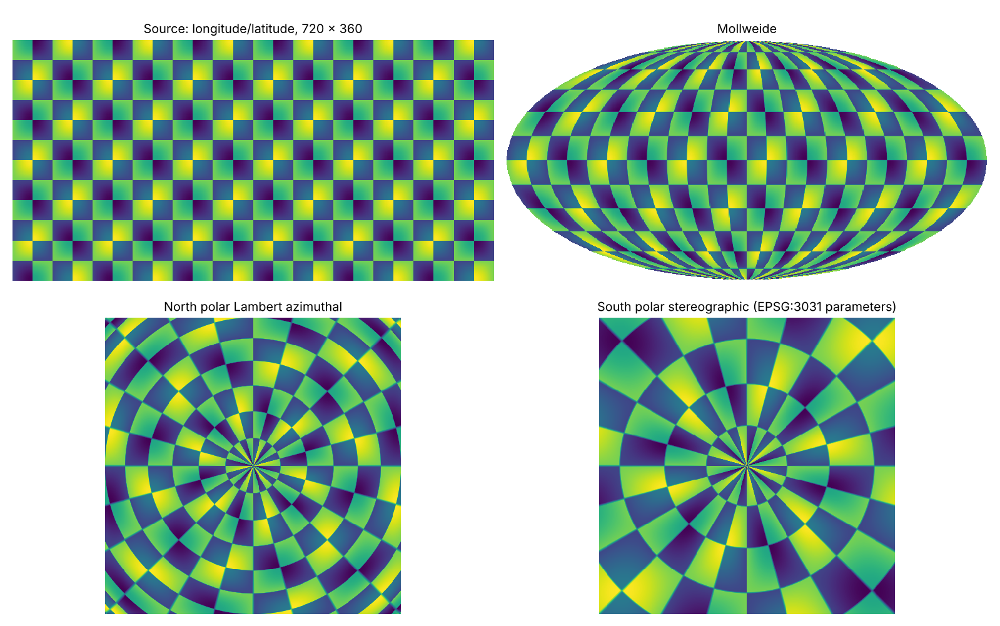

# wxylib/py

Python package `wxy`: Python bindings for wxylib, via
[pyo3](https://pyo3.rs) and [maturin](https://www.maturin.rs).

This is a minimal spike, the twin of the R spike in
[wxylib/r](https://github.com/wxylib/r). It binds the same three functions
from [wxylib/core](https://github.com/wxylib/core), chosen because they are
pure Rust: no I/O, no C libraries, and CRS work through the `proj4rs`
backend that [rwarp](https://github.com/hypertidy/rwarp) uses. numpy arrays
go in and come out.



The figure is one numpy array warped three times by `wxy.warp()`; the code
is in [tools/readme_figure.py](tools/readme_figure.py).

```python
import numpy as np
import wxy

# warp an array (row 0 at the north edge) to south polar stereographic
lat = np.arange(89.5, -90, -1.0)
z = np.repeat(lat[:, None], 360, axis=1)
w = wxy.warp(z, (-180, 180, -90, 90), "EPSG:4326",
             dst_extent=(-5e6, 5e6, -5e6, 5e6), dst_dim=(200, 200),
             dst_crs="+proj=stere +lat_0=-90 +lat_ts=-71 +datum=WGS84",
             resample="bilinear")
w.shape
# (200, 200)

# is this coordinate vector regular? (the R2 -> R1 test of the position
# ladder in design doc 02: does it reduce to an origin and a step?)
r = wxy.regular(np.arange(-179.5, 180, 1.0))
r["regular"], r["origin"], r["step"]
# (True, -180.0, 1.0)

# geotransform from extent and dimension
wxy.affine((0, 10, 0, 5), (10, 5))
# (0.0, 1.0, 0.0, 5.0, 0.0, -1.0)
```

Arrays are `(nrow, ncol)` with row 0 north, as numpy and image libraries
draw them; extents are `(xmin, xmax, ymin, ymax)` and dimensions
`(ncol, nrow)`, the same conventions as the R package. Any numeric dtype
or memory layout is accepted and read as float64; the result is float64
with NaN where nothing maps. The warp releases the GIL.

## Building

Needs Python 3.9 or later, numpy, and a Rust toolchain (`cargo`, `rustc`).

```sh
python -m venv .venv && . .venv/bin/activate
pip install maturin pytest
maturin develop --release
pytest tests --doctest-modules python/wxy
```

One abi3 wheel covers every Python from 3.9 on. The Rust crate pins the
wxylib crates to a wxylib/core commit, so the bindings move only when that
pin moves.

## What the spike does not do yet

- Published wheels (PyPI, conda-forge), and Windows and macOS builds.
- Reading files (COG, Zarr), PROJ itself, datum grids, C codecs. Those wait
  until the C ABI and Arrow interchange layers exist (design doc 03). Arrow
  is the intended way to hand tables and chunk references between Rust,
  Python and R without copying; this spike only passes numpy arrays.
- Bands, nodata in, integer output: `wxy.warp()` takes one 2-d array.
- xarray: no coordinates or CRS travel with the arrays yet.
- Type stubs (`.pyi`).

Documentation: **https://wxylib.github.io/docs/**, one place for what works, how-tos,
explainers, the design documents and how to help.

License: MIT OR Apache-2.0.
